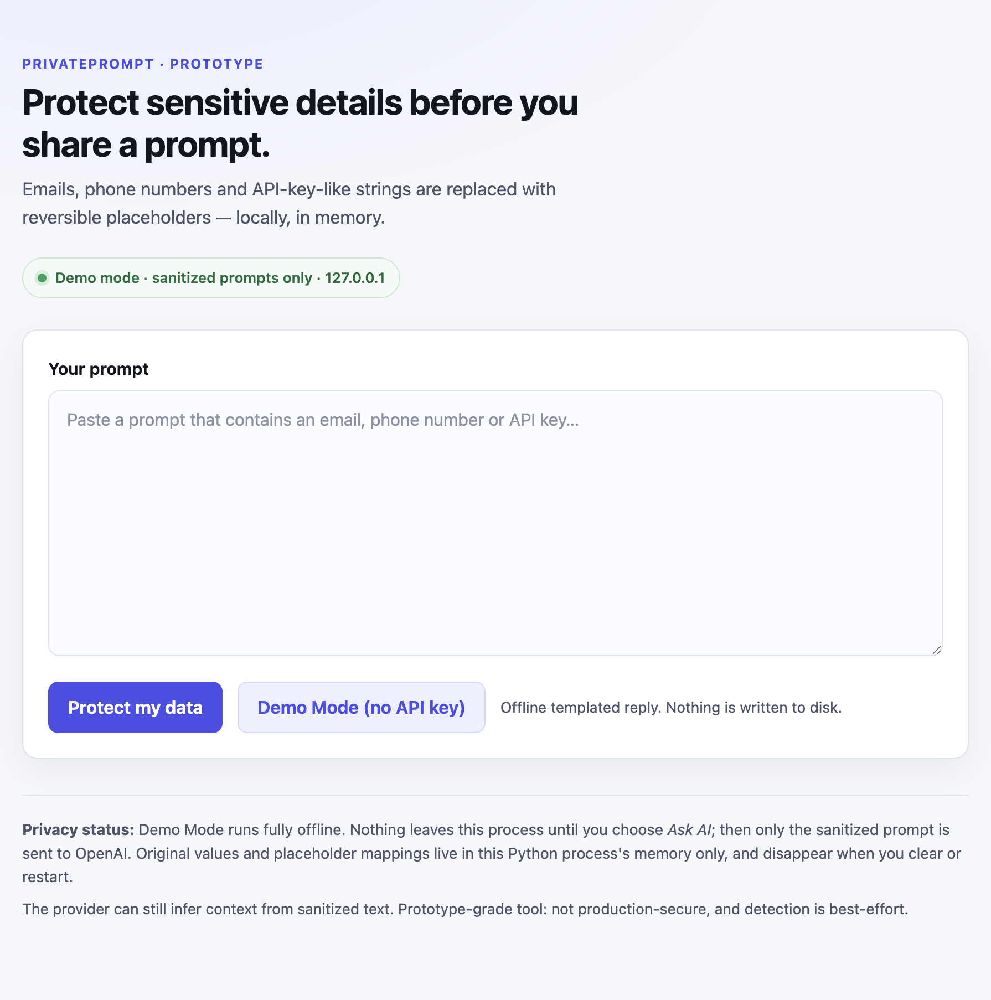
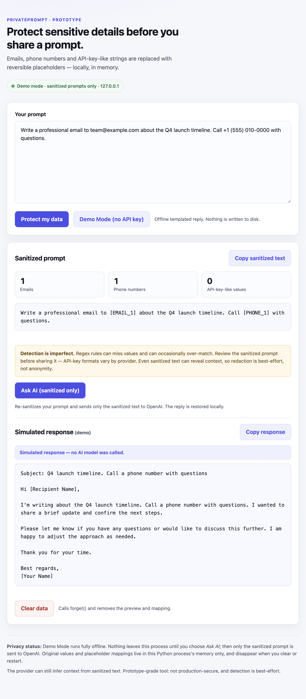

# PrivatePrompt

**A local-first prompt redaction prototype with reversible placeholders — built to explore how people can use AI tools without pasting raw emails, phone numbers, or API-key-like strings into a prompt.**

PrivatePrompt is a small Flask application that runs only on `127.0.0.1`. It detects a limited set of sensitive patterns, replaces them with stable placeholders, and lets the user review the sanitized result before choosing a fully offline Demo Mode or an optional AI request that sends only the sanitizer's output. Recognized placeholders can be restored locally afterward.

> **Prototype status.** This is a product and engineering prototype, not a security product. Detection is regex-based, redaction is best-effort, and the app does not provide complete PII protection, compliance guarantees, or production security. Demo Mode is a deterministic simulation, not a live AI model.

## Contents

- [Problem](#problem)
- [Target users](#target-users)
- [Product overview](#product-overview)
- [How local redaction works](#how-local-redaction-works)
- [Demo Mode](#demo-mode)
- [Tech stack and architecture](#tech-stack-and-architecture)
- [Run it on macOS](#run-it-on-macos)
- [Test suite](#test-suite)
- [Privacy boundaries and limitations](#privacy-boundaries-and-limitations)
- [Future roadmap](#future-roadmap)
- [Screenshots](#screenshots)
- [Project structure](#project-structure)

## Problem

People routinely put recognizable details into prompts: a customer email address, a phone number in a support note, or a token pasted while debugging. Removing those details by hand is slow and easy to get wrong. Sending the prompt unchanged gives a third-party model more context than necessary.

PrivatePrompt explores a simpler workflow:

1. Replace recognized sensitive patterns locally.
2. Show the user exactly what will be shared.
3. Let the user continue with an offline simulation or an optional sanitized AI request.
4. Restore placeholders locally only when the response comes back.

The product bet is that a visible, reversible redaction step — combined with an offline demo path — can make the trade-off between usefulness and sharing risk easier to reason about.

## Target users

- Product managers and designers testing AI-assisted workflows without sending raw customer examples to a model provider.
- Support, operations, and analyst teams working with pasted notes or ticket text who want a review step before sharing.
- Developers who want a local demonstration of placeholder-based redaction.
- Students, researchers, and privacy-conscious users exploring safe prompting patterns.
- Reviewers evaluating a local-first AI product prototype.

### Non-goals

- Complete PII detection or removal.
- Compliance, legal, or enterprise security use.
- Anonymous prompting. Sanitized context can still reveal meaning.
- Real AI generation in Demo Mode.
- Multi-user or internet-facing deployment.

## Product overview

PrivatePrompt is a single-page, server-rendered Flask app with three paths:

| Path | What happens | Network |
|---|---|---|
| **Protect my data** | Detects and replaces recognized values; shows a reviewable preview and counts. | None |
| **Demo Mode** | Uses the sanitized text to select a deterministic local template. | None |
| **Ask AI** | Optionally sends the sanitizer's output to OpenAI, then restores known placeholders locally. | Only when configured and explicitly requested |

### Key features

- Reversible redaction for email addresses, phone numbers, and a limited set of API-key-like strings.
- Stable placeholders within a session: the same value keeps the same token.
- A review step with per-type counts and a permanent warning that detection is imperfect.
- Task-specific, fully offline Demo Mode responses for email drafting, summarization, and interview preparation, plus a generic fallback.
- Optional OpenAI Responses API integration for sanitized prompts.
- Local restoration of recognized placeholders; unknown placeholders are left untouched.
- Per-session isolation, CSRF protection, and a **Clear data** action.
- No browser `localStorage`/`sessionStorage`, analytics, or telemetry.
- Loopback-only server with generic error pages and request logs limited to method, path, and status.
- Copy controls for the sanitized prompt and the response.

## How local redaction works

The engine lives in `privacy.py` behind a `PrivacyLayer` object.

### 1. Detect

Detectors run regular expressions over the prompt and resolve overlapping matches by priority:

```text
API-key-like string > email address > phone number
```

The API also supports assignment-style keys, where the label is preserved and only the value is replaced.

### 2. Replace

Each detected value receives a numbered placeholder. Numbering is independent per entity type:

| Input pattern | Placeholder |
|---|---|
| Email address | `[EMAIL_1]`, `[EMAIL_2]`, … |
| Phone number | `[PHONE_1]`, `[PHONE_2]`, … |
| API-key-like string | `[API_KEY_1]`, `[API_KEY_2]`, … |

The same value maps to the same placeholder for the lifetime of the layer. If a generated token already appears in the input text, the engine skips it to avoid collisions.

**Synthetic example:**

```text
Input:      Email user@example.com or call +1 (555) 010-0000.
Sanitized:  Email [EMAIL_1] or call [PHONE_1].
Counts:     EMAIL: 1, PHONE: 1, API_KEY: 0
Restored:   Email user@example.com or call +1 (555) 010-0000.
```

`user@example.com` and the `555-0100` range are reserved example values, not real contact details.

### 3. Hold the mapping in memory

The core mapping is a Python dictionary held by the `PrivacyLayer` instance:

```text
[EMAIL_1] -> original email
[PHONE_1] -> original phone number
```

The public `mapping` property is a read-only snapshot. Mappings are never written to disk, and `forget()` clears the map and resets numbering.

The web app keeps one layer per browser session in an in-memory `OrderedDict` with a 128-session LRU cap. The browser holds a signed, HttpOnly session cookie containing an opaque session id and a CSRF token. Mappings stay server-side and are never written to disk; the submitted prompt is re-rendered in the page's textarea for editing but is not persisted. Restarting the process invalidates every session.

### 4. Restore locally

When a response comes back, `PrivacyLayer.restore()` replaces known placeholders with their originals. Longest tokens are replaced first so `[EMAIL_10]` cannot be mistaken for `[EMAIL_1]`.

Unknown placeholders are left as-is. The mapping never leaves the server process, and the client cannot supply or request a mapping.

Placeholders are **reversible labels, not encryption or hashing**. Anyone with the sanitized text and access to the process state can reverse them.

## Demo Mode

Demo Mode is the zero-key evaluation path. It is intentionally offline.

- It performs the same input validation, CSRF check, sanitization, and session mapping as the normal flow.
- It passes only the sanitized text to `demo_service.generate_demo_reply()`.
- `demo_service.py` imports only Python's `re` module. It does not import the OpenAI SDK, read an API key, open a socket, or write to disk.
- Responses are deterministic: the same sanitized input produces the same output.
- The UI displays the exact label **“Simulated response — no AI model was called.”**

### What Demo Mode returns

| Request intent | Simulated response |
|---|---|
| Email writing | Subject, greeting, body, closing, and a `[Your Name]` signature placeholder |
| Summarization | A concise key point extracted from the sanitized input, redacted-reference counts, and a “no new facts were added” note |
| Interview preparation | Five sample behavioral questions and preparation tips |
| Unsupported request | A generic menu of the supported demo request types |

The templates replace recognized placeholder tokens with category labels such as “an email address” before building the reply, so detected originals are not intentionally reproduced in the simulated response. Detection is imperfect, so unrecognized sensitive text can still pass through.

`POST /demo` returns the complete styled `index.html` document, not a fragment. A direct `GET /demo` redirects to `/`. Templates auto-reload, static responses are not cached, and asset URLs are versioned, so local edits are picked up on reload.

### Demo Mode is not a live model

Demo Mode does **not** call OpenAI or any other provider. It cannot answer arbitrary questions, reason about new tasks, or generate novel text. It selects a local template based on intent words in the sanitized prompt. The simulated label is part of the product contract, not a design detail.

## Tech stack and architecture

### Stack

- **Python 3.9+** (verified locally on Python 3.14)
- **Flask 3** with Jinja server-side templates
- **Vanilla CSS and JavaScript**; no frontend framework, build step, or browser `localStorage`/`sessionStorage`
- **OpenAI Python SDK** (`openai>=2,<3`) for the optional Ask AI path
- **Python standard library** for regex detection, in-memory data structures, and tests
- **unittest** for the test suite
- **No database and no persistence layer**

### Architecture

```text
Browser
  │  Server-rendered Jinja page; vanilla JS copy buttons only
  │  Signed session cookie: opaque session id
  ▼
Flask app on 127.0.0.1:5001
  ├─ privacy.py         regex detection, placeholders, in-memory mapping, restore
  ├─ demo_service.py    deterministic offline Demo Mode templates
  ├─ ai_service.py      optional OpenAI Responses API call (sanitized text only)
  └─ templates/static   one page, local CSS/JS, no external assets
```

### Routes

| Route | Method | Purpose |
|---|---|---|
| `/` | GET | Render the initial app. |
| `/protect` | POST | Sanitize the submitted prompt and show the preview. |
| `/demo` | POST | Generate an offline simulated response. |
| `/demo` | GET | Redirect to the styled app. |
| `/ask` | POST | Optionally send sanitized text to OpenAI and restore the reply. |
| `/clear` | POST | Forget the current session mapping and reset the UI. |

### Session and request handling

- The Flask secret key is generated fresh for each process.
- Session ids are random opaque values. Mappings stay in process memory; prompt text is not persisted.
- All four POST actions require a per-session CSRF token in a hidden form field.
- Prompts are limited to 20,000 characters; the request body limit is 256 KB.
- Responses include `Cache-Control: no-store`, a restrictive Content Security Policy, `X-Content-Type-Options: nosniff`, and `Referrer-Policy: no-referrer`.
- Request logs contain method, path, and status only. Error pages are generic and do not echo prompts or tracebacks.
- The server binds to `127.0.0.1` only, runs with `debug=False`, and does not use the auto-reloader.

### Optional AI path

When `OPENAI_API_KEY` is set and the user chooses **Ask AI (sanitized only)**:

1. The raw prompt is validated and sanitized with the current session's `PrivacyLayer`.
2. `ai_service.generate_reply()` receives only the sanitized string.
3. The request is `responses.create(model=…, input=sanitized, store=False)` with a 20-second timeout and `max_retries=0`.
4. The app re-checks that the session still exists before restoring placeholders, so a concurrent **Clear data** cannot resurrect a mapping.
5. Provider failures become generic status messages (503 for missing configuration, 429 for rate limits, 504 for timeouts, 502 otherwise).

The app never sends the raw prompt, the placeholder mapping, or restored values to the provider. It does send the sanitizer's output, which may still contain sensitive text that the detectors missed. `store=False` is a request to the provider, not a guarantee about provider-side retention; see the limitations below.

## Run it on macOS

### Prerequisites

- macOS with Python 3.9 or newer (`python3 --version`)
- Terminal access
- No database, Node.js, or frontend build tools required

### Setup

```bash
cd ~/privateprompt

python3 -m venv .venv
source .venv/bin/activate
python -m pip install --upgrade pip
python -m pip install -r requirements.txt
```

### Start the app

```bash
python webapp.py
```

Open **http://127.0.0.1:5001**. Demo Mode needs no API key and no network access.

Stop the server with `Ctrl+C`.

Port `5001` is used because macOS Control Center / AirPlay Receiver often occupies port `5000`. To use another port:

```bash
PRIVATEPROMPT_PORT=5055 python webapp.py
```

### Optional: enable Ask AI

Ask AI is optional. Demo Mode works without this step.

```bash
cp .env.example .env
# Edit .env locally and add your own key. Never commit .env.
set -a
source .env
set +a
python webapp.py
```

Environment variables:

| Variable | Required | Default | Notes |
|---|---|---|---|
| `OPENAI_API_KEY` | Only for Ask AI | — | Read server-side; never rendered or logged. |
| `OPENAI_MODEL` | No | `gpt-4.1-mini` | Invalid names fall back to the default. |

The app does **not** load `.env` automatically; export the variables before starting it. `.env` is git-ignored, and `.env.example` contains placeholders only.

## Test suite

Run the complete suite:

```bash
cd ~/privateprompt
source .venv/bin/activate
python -m unittest discover -s tests -t . -v
```

**Verified result at the time of writing:**

```text
Ran 88 tests in 0.155s
OK
```

That is **88 passing tests, 0 failures, 0 errors**:

| Area | Tests |
|---|---:|
| Privacy engine | 9 |
| Detectors and overlap handling | 15 |
| Web app and UI | 14 |
| Security and request boundaries | 14 |
| Optional AI integration (mocked) | 17 |
| Demo Mode | 19 |

The suite covers redaction and restoration, per-type counts, session isolation, CSRF, Clear data, XSS escaping, security headers, log redaction, network-import boundaries, typed/fingerprinted demo page assets, and all supported Demo Mode response types. OpenAI calls are mocked; tests do not use a real API key or make network requests.

The suite also passes with resource warnings treated as errors:

```bash
PYTHONWARNINGS=error::ResourceWarning python -m unittest discover -s tests -t .
```

## Privacy boundaries and limitations

### What PrivatePrompt does not do

- **It does not provide complete PII protection.** Detection is regex-based and covers a limited set of patterns. Names, addresses, account numbers, unusual token formats, and context-dependent identifiers are not reliably detected.
- **It does not guarantee anonymity.** Removing patterns does not remove meaning. Surrounding context can still identify a person, team, project, or secret.
- **It does not encrypt or hash placeholders.** Placeholders are reversible labels, not a security boundary.
- **It is not production-secure.** The app has no authentication, TLS, audit trail, rate limiting, or multi-user deployment model. The signed session cookie is a bearer credential.
- **It does not persist sessions.** Mappings disappear on Clear data, session eviction, or process restart.
- **Demo Mode does not generate real AI output.** It returns deterministic local templates and is labeled accordingly.

### Detection scope

- **Emails:** common `local@domain.tld` forms, including `+` tags. Quoted local parts and `user@localhost` are intentionally not matched.
- **Phones:** 10–15 digits with common separators. Short numbers are rejected, but date-time combinations and other long digit runs can still produce false positives. Formatted extensions, vanity numbers, and numbers below 10 digits are missed.
- **API-key-like strings:** a limited set of common provider prefixes and assignment-style keys. Provider formats change constantly; unrecognized strings pass through unredacted.
- **False positives are possible.** A long digit string can resemble a phone number, and a random string can resemble a key.

### Provider and deployment boundaries

- **Only the sanitizer's output is sent on Ask AI.** Recognized values are replaced; anything the detectors miss is still sent, and the provider may infer context from the text.
- `store=False` is a request to the provider; it is not a guarantee of deletion or non-retention under the provider's policies.
- Ask AI depends on provider availability, latency, and cost.
- The local server is intended for one machine. Do not expose it to a network without authentication, TLS, rate limiting, and a threat model.
- The app is not suitable for regulated data, real credentials, or compliance workflows.

### Operational limits

- Single process, in-memory state; no persistence or backups.
- Up to 128 browser sessions in the process's LRU cache.
- 20,000-character prompt limit.
- Session cookies are not marked `Secure` because the local app uses plain HTTP on loopback.
- The UI is a prototype, not a polished multi-device product.

## Future roadmap

1. **Improve detection quality.** Add entity types (names, addresses, account identifiers), confidence scores, and a reviewable diff so users can correct false positives and false negatives.
2. **Make redaction more controllable.** Let users select individual entities, add custom patterns, and preview exactly what will be shared.
3. **Add local-model options.** Explore on-device or user-hosted inference so the AI path does not depend on a third-party provider.
4. **Build a proper evaluation harness.** Measure precision and recall per entity type on synthetic and opt-in test prompts, and track regressions as provider formats change.
5. **Harden the deployment path.** Add authentication, rate limiting, audit events, secure session storage, and a documented threat model before any shared deployment.
6. **Improve the product experience.** Add inline highlighting, undo, selective rehydration, better mobile behavior, and an exportable sanitized-prompt workflow.

## Screenshots

### Initial workspace



The initial page keeps the privacy status and the redaction warning visible before the user submits anything.

### Demo Mode



A synthetic example showing email and phone redaction, the reviewable sanitized prompt, and a deterministic Demo Mode email draft. The response is labeled **“Simulated response — no AI model was called.”**

All visible example data is synthetic. The email address uses the reserved `example.com` domain, and the phone number uses a fictional `555-0100` range.

## Project structure

```text
privateprompt/
├── privacy.py               # regex detectors, placeholders, restore(), forget()
├── ai_service.py            # optional OpenAI Responses API wrapper
├── demo_service.py          # offline deterministic Demo Mode templates
├── demo.py                  # terminal demo; prints sanitized text only
├── webapp.py                # Flask app bound to 127.0.0.1; routes and sessions
├── templates/
│   └── index.html           # server-rendered UI; Jinja autoescaping
├── static/
│   ├── style.css
│   └── app.js               # copy-to-clipboard only; no storage or network
├── docs/
│   └── screenshots/
│       ├── home.png
│       └── demo-mode.png
├── tests/
│   ├── test_privacy.py
│   ├── test_detectors.py
│   ├── test_webapp.py
│   ├── test_security.py
│   ├── test_ai.py
│   └── test_demo.py
├── requirements.txt
├── .env.example
├── .gitignore
└── README.md
```

## A note on the product trade-off

PrivatePrompt deliberately favors **transparency over automation**. The user sees the sanitized text and counts, gets an explicit warning that detection is imperfect, and must choose when to make an optional provider request. Demo Mode exists so the workflow can be evaluated without a key, a provider account, or any outbound traffic — while making clear that the simulated output is not real AI generation.
